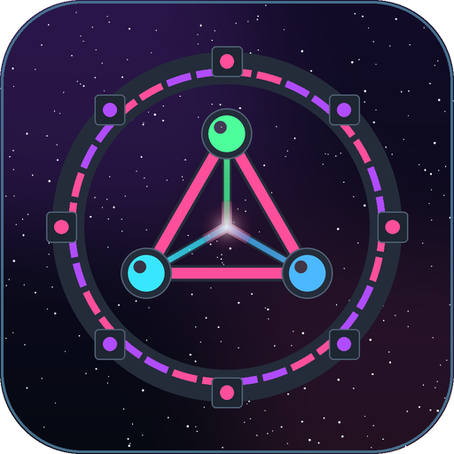

  

<h1 align="center">QNet</h1>

  Industrial tech from the first dynamo to dimensional rifts: build animated multiblock factories, run simulated reactors from fission to fusion and mine virtual dimensions with rift gates. Recipes adapt to other mods' materials. 
  For Fabric and NeoForge.

  <a href="#downloads">Download</a> ·
  <a href="#version-status">Versions</a> ·
  <a href="../../wiki">Wiki</a> ·
  <a href="api/README.md">API for mod developers</a> ·
  <a href="#license">License</a>

This repository holds the documentation, the [wiki](../../wiki), the
[issue tracker](../../issues) and the [API for mod developers](api/README.md). The mod itself
is downloaded from Modrinth or CurseForge. QNet is not open source; see [License](#license).

## What QNet is

<!-- 3–6 bullet points: what the mod adds, what makes it different. Only claim what is built and tested. -->

## Works with other mods

<!-- Loader interfaces used, built-in optional integrations (never required), honest limits. -->

## Version status

| Minecraft | Fabric jar | NeoForge jar |
|---|---|---|
| 1.21.1 | `qnet-<version>+mc1.21.1-fabric.jar` | `qnet-<version>+mc1.21.1-neoforge.jar` |

"Tested" means, for every listed version: client and dedicated server started, all automated game
tests passed, and the integrations were started with the real mods. The exact loader versions are
listed in the wiki under [Supported Versions](../../wiki/Supported-Versions).

## Performance

<!-- Only measured numbers, with hardware, game version and scene. No TPS promises. -->

## Downloads

[Modrinth](https://modrinth.com/project/qnet)
[CurseForge](https://www.curseforge.com/minecraft/mc-mods/qnet/)

Please download QNet only from these pages. Pick the file whose name contains your
Minecraft version, for your loader.

## Reporting bugs

Please open an [issue](../../issues/new/choose) with the Minecraft version, the loader and its
version, the jar name, the other mods involved, and `logs/latest.log` (plus a crash report if
there is one).

## License

QNet is **not open source**. All rights reserved by cptgummiball; see [`LICENSE`](LICENSE).
In short:

* You may play with QNet, use it on any server and show it in videos and streams.
* You may put QNet into **modpacks**, as long as the jar files stay exactly as published.
* You may **not** modify, decompile, re-upload or otherwise redistribute QNet, or use its
  assets elsewhere.
* Mod developers may compile against the [QNet API](api/README.md).
* For anything else, open a [permission request](../../issues/new?template=permission_request.yml).

QNet is made by **cptgummiball**. It is not an official Minecraft product and is not
associated with Mojang or Microsoft.
