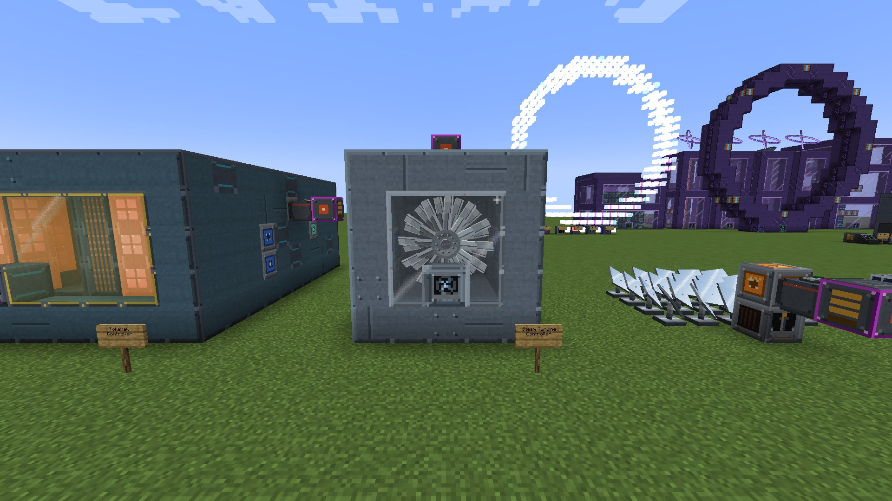
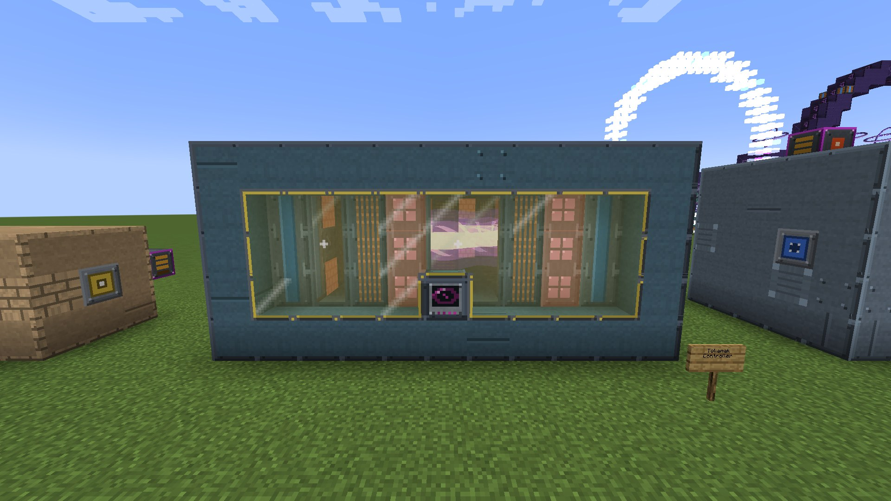
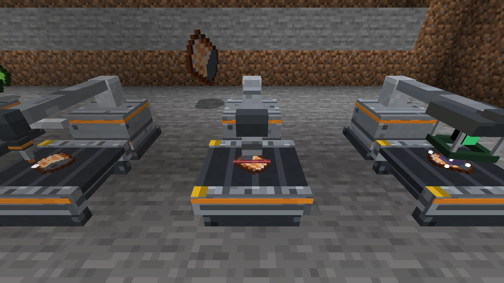
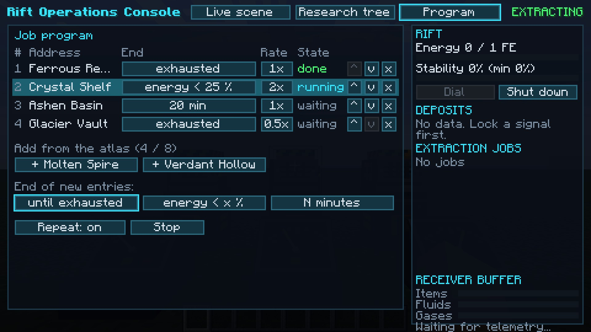
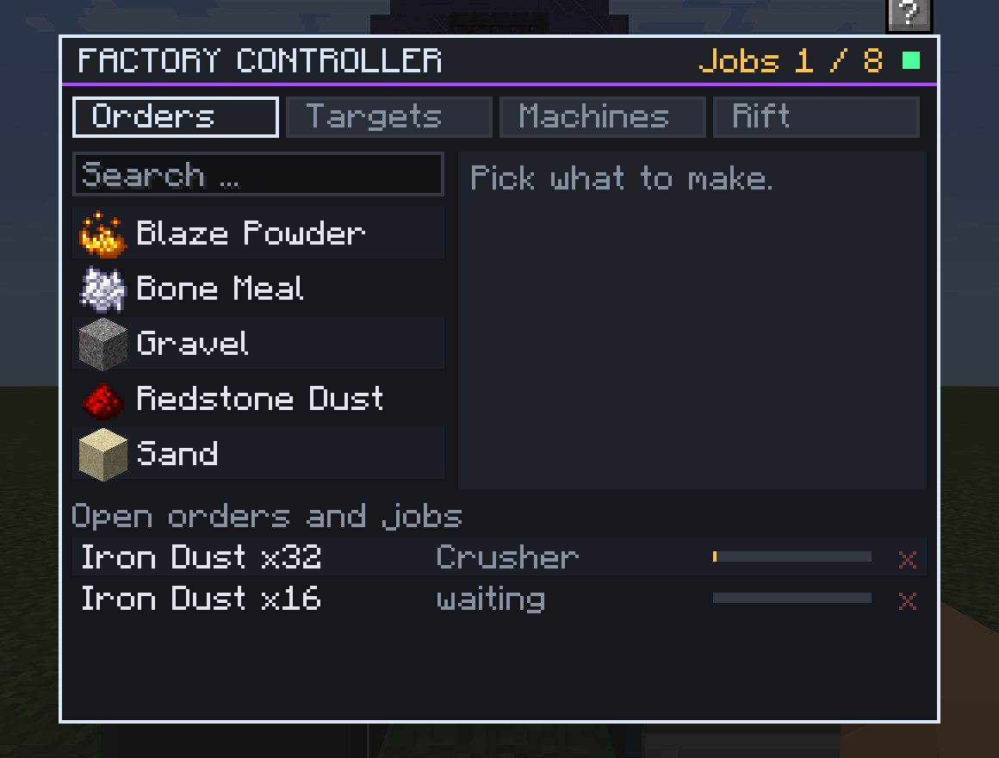
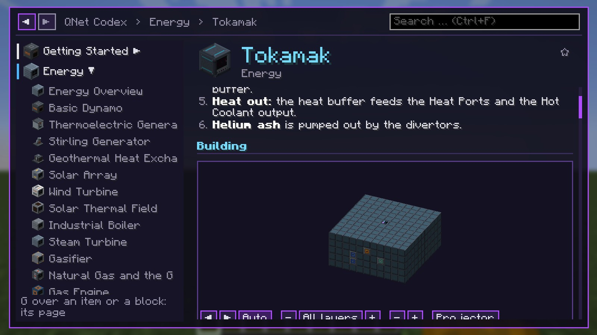
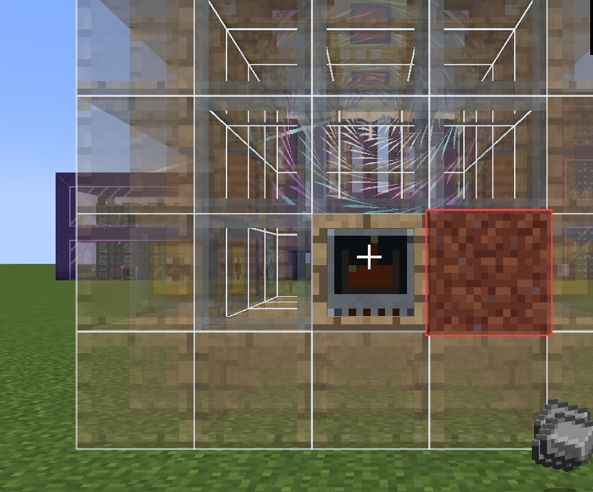

  

<h1 align="center">QNet</h1>

  <b>Industrial tech from the first dynamo to dimensional rifts:</b> build animated multiblock factories, run simulated
  reactors from fission to fusion and mine virtual dimensions with rift gates. Recipes adapt to other mods' materials. 
  For Fabric and NeoForge.

  
  
  
  
  
  

  <a href="#downloads">Download</a> ·
  <a href="#version-status">Versions</a> ·
  <a href="https://github.com/CptGummiball/QNet/issues/new?template=version_request.yml">Request a version</a> ·
  <a href="../../wiki">Wiki</a> ·
  <a href="api/README.md">API for mod developers</a> ·
  <a href="#license">License</a>

This repository holds the documentation, the [wiki](../../wiki), the [issue tracker](../../issues) and the
[API for mod developers](api/README.md). The mod itself is downloaded from Modrinth or CurseForge. QNet is not open
source; see [License](#license).

QNet is an industrial tech mod for players who like to **build** their industry. Almost everything beyond the first
machines is a plant: casings, sight glass, ports and hatches around a controller that checks the build and runs it.
Most plants come in many sizes, and the bigger or better equipped a plant is, the more it does.

* **One connected tech tree** from a coal-fired dynamo to fusion, black holes and rifts into other dimensions, with its
  own storage network and factory logic on top. QNet brings together what used to be QuantaVolt, QuantaWorks and
  QuantaRift.
* **Real simulations** instead of "insert coal, receive power": steam has pressure and temperature, turbines spin up and
  can overspeed, reactors have flux, heat and control rods, plasma needs vacuum and magnets. Failures are announced in
  advance and always reproducible, never random.
* **Every machine and plant is animated:** rotors turn, pistons move, furnaces glow, the harvest bridge of the
  greenhouse rolls across its beds, the Assembler prints its item layer by layer.
* **Five tiers, one ladder:** Industrial, Reinforced, Precision, Resonant and Quantum. A shared manufacturing chain makes
  every block need the components of its tier, whatever part of the mod it comes from.
* **Recipes adapt to other mods' materials:** if another mod adds tin, lead or its own steel, QNet's machines make plates,
  rods, gears and wire from it like from iron and copper.
* **Learn it in the game:** a full in-game codex in English and German with values taken from the mod itself, and a
  Build Projector that shows every plant as a hologram before you place a block.

  

A full energy ladder from the first hour to the endgame:

* **Early:** Basic Dynamo, Thermoelectric Generator (hot and cold blocks), Stirling Generator (heat from below), Solar
  Array, Wind Turbine.
* **Steam:** Industrial Boiler and Steam Turbine. Burn fuel or fuel gas, or use heat from a Geothermal Heat Exchanger or
  a Solar Thermal Field.
* **Gas:** a Gasifier for syngas, natural gas from gas fields with the Gas Derrick, then Gas Engines and Gas Turbines.
* **Nuclear:** a Fission Reactor with its fuel cycle (centrifuge cascade, fuel fabrication, spent fuel and
  reprocessing), coolant loops and radiation, plus an optional advanced reactor model for those who want more control.
* **Fusion and beyond:** the Tokamak, the Little Star, the Singularity Plant and the Hawking Reactor.
* **Storage:** Battery Hall, Capacitor Bank, SMES, Molten Salt Store, Gravity Store and the Dimensional Store.
* **Process heat:** heat ports pass heat between plants: a Tokamak or the exhaust of a gas turbine can heat a boiler, a
  Foundry or the Chemical Plant directly.

Server owners decide how dangerous incidents may be: from a protective safe mode that only overheats and shuts down,
up to bursts and meltdowns that damage terrain (never in claimed land).

  

Single machines for the first steps (Crusher, Induction Furnace, Metal Former with interchangeable dies, Assembler with
pattern cards, Chemical Reactor, Electrolyzer, Crystallizer and more) and large plants for the later game:

* the **Foundry** and the **Tunnel Furnace** (on QNet conveyor belts) for metals,
* the **Chemical Plant** with several process columns,
* the **Assembly Complex**, a production line of stations: press, robot arms, laser welder, inspection,
* the **Agricultural Facility**, an indoor farm with planter beds and a harvest bridge, and field machines that farm and
  fell trees outdoors,
* the **Deep Core** drill, the **Matter Reconstructor**, the **Particle Facility** and the **Quantum Facility**.

Machines take speed and parallel upgrades, plants take plant modules.

  

The endgame: a complex of large structures that finds **virtual dimensions**, opens a rift to one of them and mines its
deposits. Nothing of these dimensions is generated in your world. They are addresses with their own rock, fluids and
gases, so the Rift costs no world generation and no chunk loading.

Scan for signals, triangulate and lock addresses, survey them, unlock better methods in a research tree, then run
extraction programs. Deposits deplete, sectors get exhausted the more you mine them, and some materials, like Rift
Crystals, exist only out there. The Rift Map Table shows the selected dimension as a hologram in your base.

  

A storage network of its own: a Storage Controller, storage units in five tiers, the Storage Access Terminal, a Bulk Tank
for fluids and gases, a Mass Storage Warehouse with its crane, and interfaces that reach chests and machines next to
them. Everything is linked with the Quanta Linker. Dropped storage blocks keep their contents.

* **Factory Controller:** order "make 64 steel plates" or "keep 500 in stock", and it plans down to the raw materials,
  reserves the inputs in the storage network and has Machine Interfaces feed free machines, also machines of other
  mods. It can start and stop Rift extraction programs to keep raw materials stocked.
* **Grid Monitor:** watches an energy grid with needle, lamps and a five-minute history, and sheds or pauses consumers
  when power runs short.
* **ComputerCraft:** with CC: Tweaked installed, every QNet machine and plant controller can be read from a computer,
  and controlled where it makes sense. The Factory Controller takes orders from computers if you allow it.

  

* A full **in-game codex** in English and German: every machine and plant has its page with recipes, values filled in
  from the mod itself (so they always match your version and your server's settings), troubleshooting tables for every
  status message and **step-by-step build guides** with a turnable 3D view.
* Press the codex key (**G** by default, rebindable) over an item, or click the **?** in a machine's window, to open its
  page directly.
* The **Build Projector** shows a plant as a hologram: pick the size and the layer, build along the ghost blocks, and see
  how many blocks are placed, missing or in the way and which materials you still lack.
* The same pages are in the [wiki](../../wiki).

  
  

* **Teams and roles:** storage, monitors, controllers and Rift blocks belong to their owner's team, with Viewer, Operator
  and Admin roles. FTB Teams, FTB Chunks and Open Parties and Claims are respected where installed, and permission mods
  can grant `qnet.admin`.
* **Server control:** each part of the mod (Energy, Processing, Rift, Storage, Logic), each integration and even single
  machines can be switched off in the server configuration. Switched-off blocks stay in the world with their contents;
  they are only frozen.
* **Server-authoritative:** all simulation runs on the server, in bounded steps, without unbounded scans and without
  force-loading chunks.
* **Old worlds:** worlds with QuantaVolt 1.0.0 or QuantaWorks 0.1.0 convert to QNet automatically when they load. Make a
  backup first.

  

* [Pipster](https://github.com/CptGummiball/Pipster): readable pipes for items, fluids, gases and energy.
* [QNet](https://github.com/CptGummiball/QNet): industry, power, storage, logistics and dimensional extraction in one mod.

QNet needs Pipster: every cable and pipe of QNet is a Pipster pipe.

* **Energy:** 1 E = 1 FE = 1 Team Reborn Energy, so generators, cables and batteries of other mods connect directly.
  Items, fluids and gases use the loader's standard interfaces (Fabric Transfer API, NeoForge capabilities).
* **Recipe viewers:** JEI, REI and EMI show every QNet recipe, including tiers, energy and gases.
* **Jade** shows the main values of machines, plants and ports.
* **Storage mods:** Applied Energistics 2 (NeoForge) can mount the QNet storage network through a storage bus; the
  external storage of Refined Storage and the Inventory Connector of Tom's Simple Storage reach it through the Storage
  Interface.
* **Create and Mekanism** (NeoForge, 1.21.1): QNet's Crusher and Metal Former also run some of their recipes.
* **ComputerCraft (CC: Tweaked), FTB Teams, FTB Chunks, Open Parties and Claims** and permission mods.

Everything except Pipster is optional and switches itself on only when the other mod is installed. Not every mod exists
for every Minecraft version; [Supported Versions](../../wiki/Supported-Versions) lists which integration is tested on
which version.

| Minecraft | Fabric | NeoForge |
|---|---|---|
| 1.21.1 | yes | yes |
| 26.1.2 | yes | yes |
| 26.2 | yes | yes |
| 26.3 | yes | yes |
| 1.21.11 | yes, released later | yes, released later |

**Minecraft 1.21.11:** supported as an optional version. Each QNet update comes out for 1.21.1, 26.1.2, 26.2 and 26.3
first; the 1.21.11 build follows later as a separate release. Pipster itself supports 1.21.11 as usual.

There is one file per Minecraft version and loader; the file name says which (for example
`qnet-1.0.1+mc26.2-fabric.jar`). Every file was started as a client and as a dedicated server, passed all of its
automated game tests (over 250 on Fabric, over 210 on NeoForge) and ran together with each supported mod that exists for
its version.

**Your version is missing?** Ask for it with a [version request](https://github.com/CptGummiball/QNet/issues/new?template=version_request.yml).
Requests with a real use (a modpack, a server) help decide which version comes next.

Measured on a dedicated server (Minecraft 1.21.1, Intel i7, Java 21) with 32 formed plants, 10 machines and a Rift
complex extracting: QNet took **0.6 to 0.8 ms per tick** (95th percentile) on both loaders, out of the 50 ms a tick may
take. Machines and plants do their work in bounded steps per tick; nothing scans the world.

* [Modrinth](https://modrinth.com/project/qnet)
* [CurseForge](https://www.curseforge.com/minecraft/mc-mods/qnet)

Required: [Pipster](https://modrinth.com/project/pipster) 1.2.0 or newer, and on Fabric the Fabric API. QNet is only
published on Modrinth and CurseForge; files from other sources are not official.

Open an [issue](../../issues/new/choose) and pick the form that fits:

* **Bug report:** something does not work as described, crashes or loses resources. Please add your Minecraft version,
  loader, the QNet and Pipster file names and `logs/latest.log`.
* **Mod compatibility:** a problem only together with another mod.
* **Feature request:** an idea for QNet.
* **Version request:** QNet for a Minecraft version that is not supported yet.
* **Permission request:** anything the license does not allow without asking.

QNet is **not open source**; all rights belong to cptgummiball. You may play it, show it in videos and streams and put
the unchanged jar files into modpacks. Changing, re-uploading or reusing its assets needs written permission. The
binding text is the [QNet License](LICENSE); the [wiki](../../wiki/License-and-Permissions) summarizes it.
